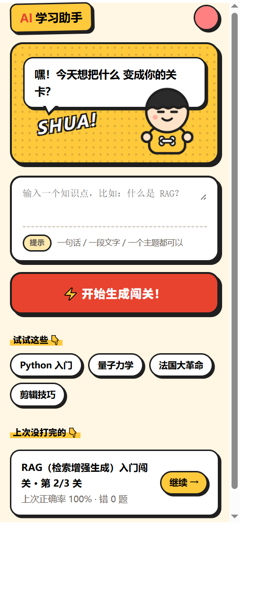
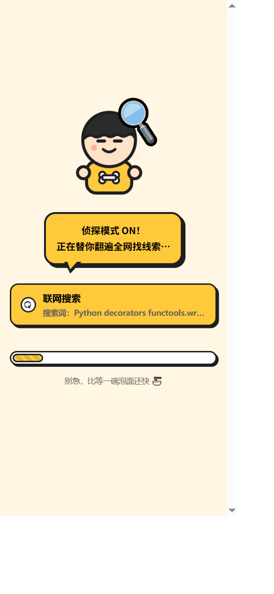
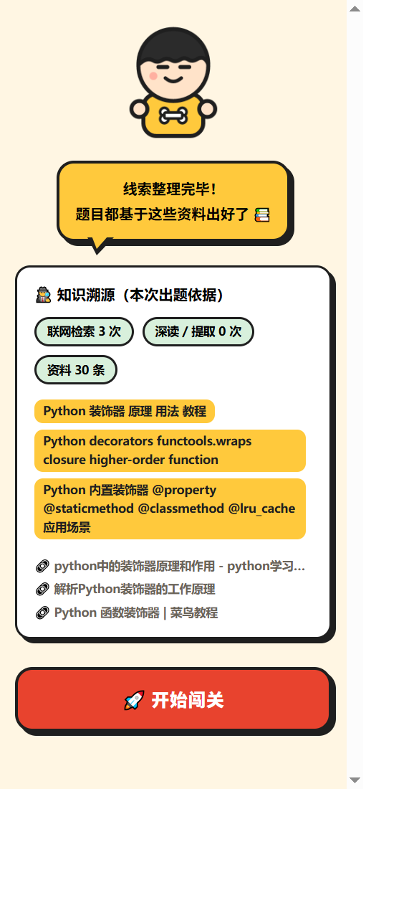
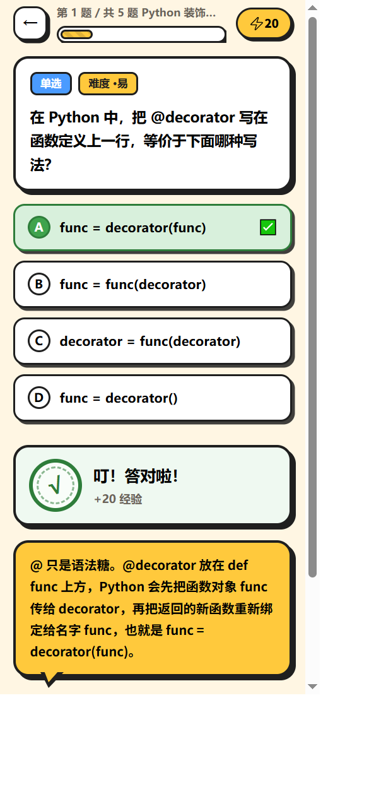
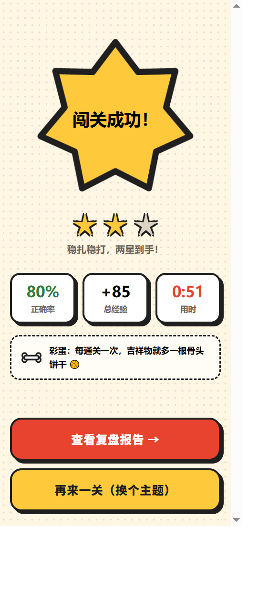
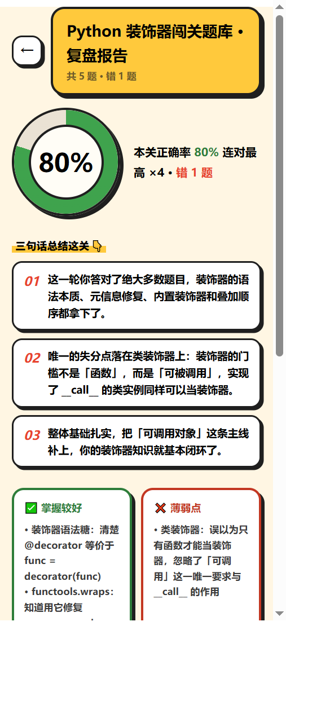
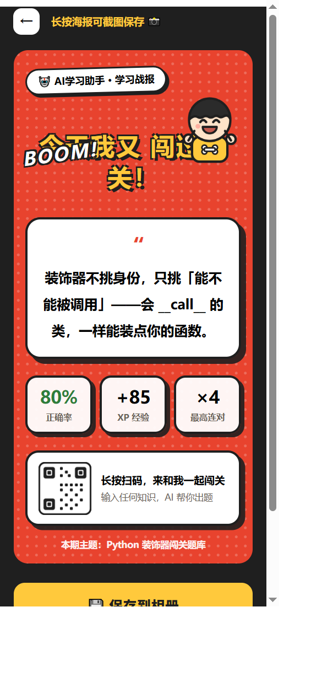
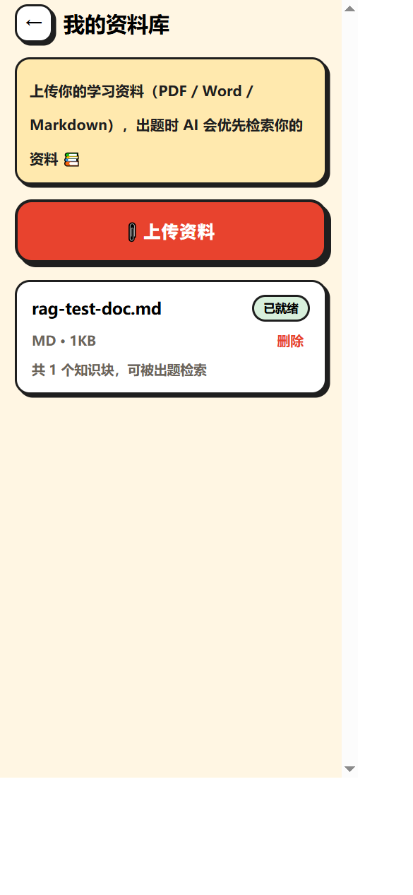
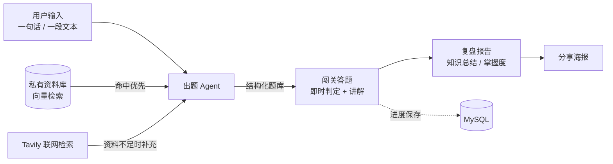

# AI学习助手

<p align="center">
  
</p>

把任意知识变成闯关问答的 AI 学习小程序。

「AI学习助手」是一个基于大模型的学习工具：输入一句话、一段文本或一份自己的资料，AI 自动生成闯关题库；答完通关后输出知识总结与复盘报告，形成「出题 → 闯关 → 复盘」的学习闭环。

## ✨ 项目特点

- 🎲 **万物皆可闯关** —— 输入任意主题或文本即可出题，支持单选 / 多选 / 判断 / 填空四种题型，可选题数（3 / 5 / 10）与难度（简单 / 混合 / 困难），每题附带详细讲解。
- 📚 **双源知识获取** —— 优先检索用户自己的资料库（PDF / Word / Markdown 上传后自动解析、分块、向量化）；资料不足时由 AI Agent 自主联网检索补充。出题结果可溯源到具体资料或网页。
- 🛡️ **知识盲区守卫** —— 知识依据不足时不硬编题目，快速失败并引导用户补充资料或更换主题，保证题目可信、不幻觉。
- 🔄 **学习闭环与资产沉淀** —— 答错即时讲解、断点续答、通关复盘报告、知识点掌握度、错题本与重做、学习统计、分享海报。
- 🎨 **游戏化沉浸体验** —— 原创「漫画闯关风」设计系统，答题即时反馈，把学习变成闯关。
- ⚙️ **面向真机的工程可靠性** —— 异步任务 + 轮询规避微信小程序 60s 请求超时上限；大模型空响应异构兜底；347 个后端测试全绿；500 条题库生成基准测试 100% 成功。
- 📱 **一套代码双端运行** —— 基于 Taro 4 + React 18，同时构建微信小程序与 H5。

## 🎯 功能一览

| 模块 | 能力 |
|------|------|
| 🎲 出题 | 主题 / 文本输入 → AI 生成题库；资料库优先 + 联网补充；生成过程实时步骤流展示 |
| 🕹️ 闯关 | 单选 / 多选 / 判断 / 填空；即答即判即讲解；进度自动保存、支持续答 |
| 📊 复盘 | 通关生成知识总结、正确率与复盘报告；一键生成学习海报分享 |
| 🗂️ 学习资产 | 历史闯关、掌握度地图、错题本重做、学习统计报表 |
| 📚 资料库 | 上传 PDF / .docx / .md，后台解析入库，出题时优先命中 |
| 👤 用户 | 微信静默登录；昵称与头像编辑 |

## � 界面预览

<p align="center">
  
  
  
  
  <br />
  
  
  
  
  <br />
  <sub>真实运行截图（H5 端，与微信小程序同源）· 更多见 doc/screenshots/</sub>
</p>

## �🛠️ 技术栈

| 层 | 选型 |
|----|------|
| 前端 | Taro 4.3 · React 18 · TypeScript · Sass · Zustand（微信小程序 + H5） |
| 后端 | Python · FastAPI · SQLAlchemy + MySQL · PyJWT |
| AI 编排 | LangChain 1.x（Agent 工具路由 + 结构化输出） |
| 大模型 | DeepSeek（`deepseek-chat`） |
| 检索增强 | Tavily 联网检索；阿里云百炼 `text-embedding-v4` + Chroma 向量库 |
| 工程 | OpenSpec 规格驱动开发 · pytest（测试中 LLM 全部 Mock，不消耗额度） |

## 🏗️ 整体架构



**关键设计**

- ⏱️ **异步任务 + 轮询**：微信小程序 `wx.request` 存在 60s 硬性超时上限，而「检索 + 出题」耗时不可控（实测 11~27s，长尾可能更高），生成流程拆为 `POST /quiz/tasks` 建任务 + 轮询查询，任务持久化，服务重启不丢。
- 🧭 **双源检索路由**：出题 Agent 挂载资料库检索与联网检索 / 网页提取工具，先私有资料、后联网补充；均无依据时输出知识盲区提示。
- 🪂 **空响应兜底**：针对大模型偶发 function calling 空响应，设计异构兜底链（工具调用 → json_mode），保障出题成功率。

## 🚀 快速开始

### 1. 后端

```bash
cd backend
python -m venv .venv
.venv/Scripts/pip install -r requirements.txt

# 配置：复制后填写 DEEPSEEK_API_KEY（必填）、JWT_SECRET、DB_PASSWORD
#      可选：TAVILY_API_KEY（联网检索）、DASHSCOPE_API_KEY（资料库）、微信登录
cp .env.example .env

# 首次：MySQL 执行 scripts/init_db.sql 建库，然后建表
.venv/Scripts/python.exe -c "from app.core.db import init_db; init_db()"

# 启动
.venv/Scripts/uvicorn app.main:app --reload --port 8000
```

接口文档（Swagger）：http://127.0.0.1:8000/docs

### 2. 前端

```bash
cd front
npm install

npm run build:weapp   # 构建微信小程序（产物 dist/），用微信开发者工具导入 front/ 目录
npm run dev:h5        # H5 调试模式（http://localhost:10086）
```

### 3. 测试

```bash
cd backend
.venv/Scripts/pytest    # 347 个用例，LLM 全部 Mock
```

## 📁 项目结构

```
backend/            FastAPI 后端
  app/api/          接口层（题库 / 报告 / 用户 / 资料库 / 错题本 / 统计）
  app/llm/          LangChain 链路（出题 / 报告 / Embedding）
  app/services/     业务服务（知识获取 Agent / 向量检索 / 生成任务 / 文档处理 ...）
  app/models/       数据模型
  scripts/          运维与验收脚本（连通性检查 / 阈值标定 / 基准测试）
  tests/            pytest 用例
front/              Taro 小程序前端（13 个页面）
  src/pages/        首页 / 生成中 / 闯关 / 报告 / 掌握 / 统计 / 错题本 / 资料库 / 海报 ...
  src/components/   通用组件（答题面板 / 页面骨架 / 吉祥物 ...）
openspec/           规格驱动开发
  specs/            能力规格（系统真实行为的单一事实源）
  changes/archive/  历史变更归档（提案 / 设计 / 规格 / 任务）
doc/                需求分析与方案设计文档 · screenshots/ 界面预览截图
```

## 📚 文档索引

- [需求分析文档](doc/需求分析文档.md)
- [方案设计文档](doc/方案设计文档.md)
- [用户系统方案设计文档](doc/用户系统方案设计文档.md)
- [能力规格（OpenSpec）](openspec/specs/)
- [后端详细说明](backend/README.md)

<p align="center">
  
  
  
  <br />
  <sub>祝你每次闯关全对 🎉</sub>
</p>
